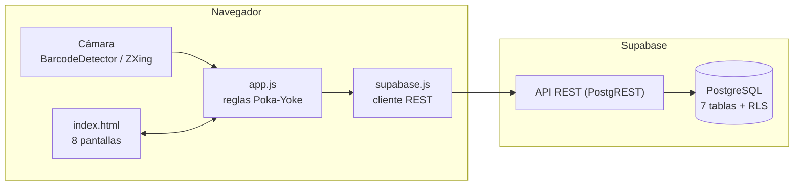

# Arquitectura de EFF-EX

EFF-EX es una **aplicación web estática** (HTML + JavaScript) que guarda su estado en **Supabase** (PostgreSQL con API REST). No hay servidor propio: el navegador habla directo con Supabase.



## Flujo de la mercancía
`Check OC` (escanear la orden) → `Etiquetas` (1 código P-### por producto) → `Asig. Rack` (escanear el rack asignado) → `Despacho` (doble escaneo rack + producto, se asigna operador) → `Unidades` (el operador regresa a base).
`Estancia $` calcula el cobro diario por orden y `Bitácora` guarda cada validación y bloqueo.

## Estructura
```
frontend/
├── index.html            las 8 pantallas y los modales
└── static/
    ├── css/ui.css        estilos y modo oscuro
    └── js/
        ├── config.js     URL y clave publishable de Supabase
        ├── supabase.js   cliente REST mínimo (fetch)
        └── app.js        reglas de negocio, render y sincronización
sql/
├── 00_limpiar_todo.sql   borra el esquema public (empezar de cero)
└── 01_schema.sql         tablas, permisos y políticas RLS
```

## Base de datos
| Tabla | Guarda |
|---|---|
| `purchase_orders` / `po_products` | Órdenes de compra y sus productos (SKU, cantidad, pasillo) |
| `lpns` | Etiquetas/tarimas: rack, estado y escaneos de despacho |
| `racks` | Mapa de 8 racks (libre, reservado, ocupado) |
| `operators` | 3 operadores y tráileres (disponible o en ruta) |
| `event_logs` | Bitácora de validaciones y bloqueos |
| `app_settings` | Consecutivos de folio/SKU y contador de bloqueos |

## Sincronización
`app.js` mantiene el estado en memoria. Cada cambio dispara un guardado (con 300 ms de espera) que compara cada tabla con lo último enviado y **solo escribe las que cambiaron**. Al abrir la app se carga todo desde Supabase; si la base está vacía, se cargan los datos de ejemplo.

## Límites conocidos
- Sin login: las políticas RLS permiten leer y escribir con la clave publishable.
- Dos dispositivos a la vez se pisan: gana el último que guarda.
